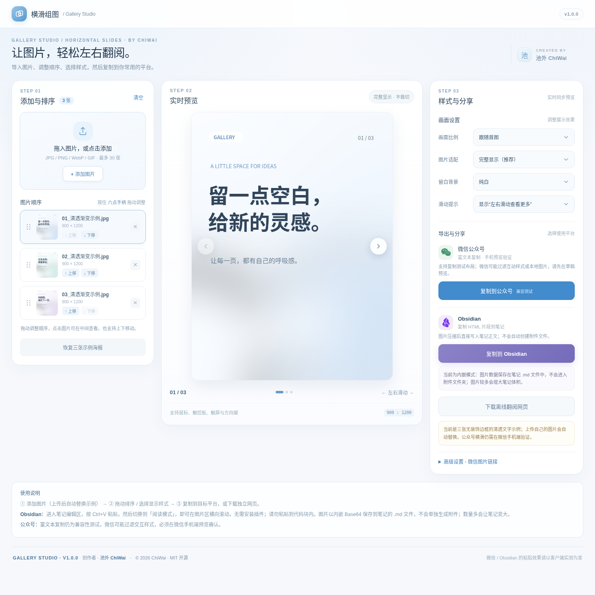

# Gallery Studio · 横滑组图

**当前版本：v1.0.0**

> 免费、离线的图片横向滑动排版小工具。选择图片、调整顺序、预览横滑，再选择目标平台导出。
>
> **创作者：池外 ChiWai** · MIT License · 本仓库保存可维护源码；可直接使用的单文件成品在 [Releases](https://github.com/ChiWai-00/Gallery-Studio/releases) 提供。



## 立即使用

在 [Releases](https://github.com/ChiWai-00/Gallery-Studio/releases) 下载 `GalleryStudio_ChiWai_v1.0.0.html`，使用 Chrome 或 Edge 双击打开即可，无需安装或注册。

本仓库的 `src/` 是便于维护的源代码，**不包含编译后的单文件 HTML**。如果希望自行构建，运行 `python scripts/build.py`，脚本会在本地生成 `dist/index.html`。

## 主要功能

- 支持拖入、批量添加 JPG / PNG / WebP / GIF 图片（最多 30 张）
- 支持平滑鼠标拖拽排序、上下移动和点击预览
- 支持 9:16、3:4、1:1、4:3、16:9 和跟随首图；完整显示或裁切适配
- 离线横滑预览、下载包含图片的独立 HTML 阅读页
- 微信公众号：将富文本横滑布局复制到剪贴板，供公众号草稿**兼容性测试**
- Obsidian：压缩后把图片内嵌为 HTML 源码，复制到笔记正文
- 无账户、无遥测；正常使用时图片在浏览器中本地处理

## 平台兼容性重要说明

| 导出目的地 | 能保证的功能 | 尚需验证的部分 |
| --- | --- | --- |
| 独立 HTML 阅读页 | 在现代浏览器中本地横向翻页 | 不代表公众号能够嵌入该 HTML |
| 微信公众号 | 尝试复制富文本及横滑样式 | 微信编辑器可能过滤样式或本地图片，需手机预览验证；**不保证一键生效** |
| Obsidian | 可复制包含压缩图片的 HTML 源码 | 不同 Obsidian 版本/主题可能过滤样式，**不保证无插件横滑** |

**Obsidian 当前不会生成附件文件。** 图像数据采用 Base64 形式写入 `.md` 文件中的 HTML 块；图片多时笔记会变大。建议每组不超过 12 张（工具内还有体积限制）。

## 仓库结构

```text
.
├── src/
│   ├── index.html                 # 可编辑的页面结构
│   ├── styles.css                 # 页面样式、控件及拖拽过渡
│   ├── app.js                     # UI 逻辑、剪贴板与导出逻辑
│   └── assets/examples/          # 三张可维护的内置示例图片
├── scripts/build.py              # 纯 Python 标准库构建脚本
├── docs/
│   ├── 使用说明.md
│   ├── 开发与构建.md
│   ├── 平台兼容性.md
│   └── assets/preview.png
├── LICENSE
├── CHANGELOG.md
└── CONTRIBUTING.md
```

## 参与开发与构建

源代码按 HTML / CSS / JavaScript 拆分，**无需 npm 或第三方依赖**。

```bash
python scripts/build.py
```

执行后会在本地生成 `dist/index.html`（此目录不提交到仓库）。详见 [开发与构建](docs/开发与构建.md)。

## 使用说明

查看 [使用说明](docs/使用说明.md)；如果复制到公众号或 Obsidian 后没有横滑，请先阅读 [平台兼容性与限制](docs/平台兼容性.md)。

## 开源许可与署名

项目代码与本仓库自带示例图片按照 [MIT License](LICENSE) 授权，版权所有 © 2026 **池外 ChiWai**。分发与修改本项目时请遵守 MIT 协议，保留版权与许可声明。

WeChat / 微信与 Obsidian 的品牌名称和图标属于各自权利人；本项目与其官方没有关联或授权背书。品牌 SVG 图标使用 Simple Icons 项目提供的图形（Simple Icons 为 CC0），但图标及品牌可能受商标法约束。请勿让用户误以为这是官方工具。

---

由 **池外 ChiWai** 创作。感谢使用与反馈。
